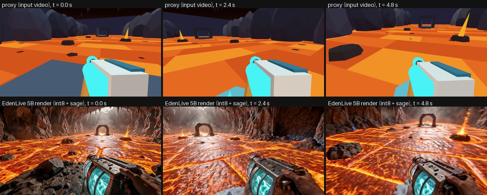
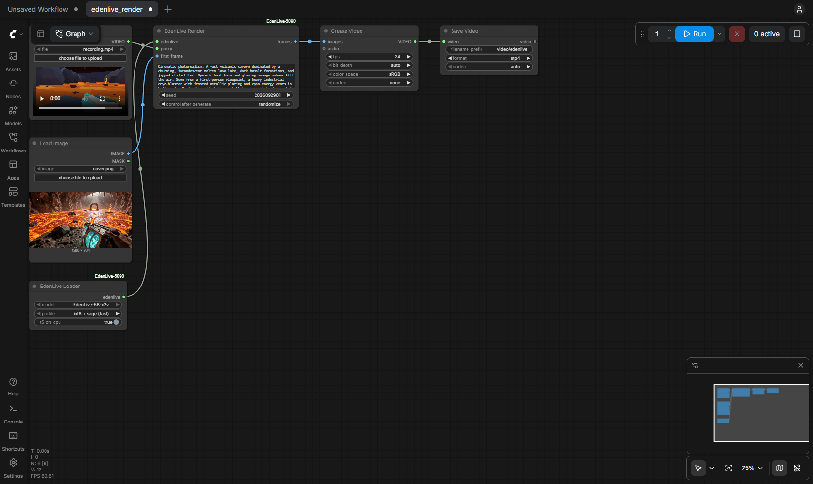

# EdenLive 5B for ComfyUI

[EdenLive](https://github.com/VAST-AI-Research/EdenLive) (VAST) renders a reference video (a greybox, a game capture, any rough
render) into detailed video, guided by a target first frame and a text prompt. The reference video sets the layout, camera motion
and timing; the first frame and the prompt set the look.

These nodes run the 5B few-step (chunk-autoregressive) model at 1280×704 and 24 fps through
[LightX2V](https://github.com/ModelTC/LightX2V)'s EdenLive runner. They call it the same way as its command line, so a seed gives
the frames `python -m lightx2v.infer --model_cls wan22_edenlive_ar` writes. Measured on Windows 11 with an RTX 5090.

This is an unofficial integration, not affiliated with VAST, ModelTC or Comfy Org.



The images above come from the first 5 s of EdenLive's `cryo-crossing` sample. The render used its `cover.png` as the first frame, its
prompt, seed 2026092901 and the `int8 + sage` profile.



## Nodes

| Node | What it does |
| --- | --- |
| **EdenLive Loader** | A model folder in `models/edenlive/`, a kernel profile, and where the UMT5 text encoder runs. |
| **EdenLive Render** | `proxy` (a VIDEO, e.g. from Load Video), `first_frame` (IMAGE), `prompt`, `seed` → the rendered frames (IMAGE, 24 fps) and the prompt of every chunk (`schedule`). Optional: `prompt_schedule` (timed prompts), `preview` (each decoded chunk shows up in the progress preview as it arrives). |

Save the frames with Create Video (fps 24) and Save Video. The example workflows are in `example_workflows/`.

### Timed prompts

`prompt_schedule` changes the text over time, the way EdenLive's own recordings describe it. It takes either

- the content of an EdenLive `prompts.json` (a `staticPrompt` and timed `dynamicPrompts` with `startMs`, `endMs`, `text`), as in
  EdenLive's `examples/samples/*/prompts.json`, or
- one event per line, `<start>: text`, with the start in frames at 24 fps (`48: ...`), seconds (`2s: ...`) or milliseconds
  (`2000ms: ...`); each event lasts until the next one, and `prompt` is the static part.

The model renders in chunks of 12 frames, and each chunk gets one prompt: the static prompt followed by the text of every event that
overlaps the chunk. That is EdenLive's own rule for its chunk-autoregressive model (`prompt_schedule` in
`edenlive/data/recording_manifest.py`); the pack's version gives the same prompts as EdenLive's on both shipped samples (CI). The
schedule reaches LightX2V as its `prompt_travel` setting for that one render, so it does not affect the next one. The `schedule`
output lists the chunks with their frames and prompts.

## Profiles

Measured with LightX2V's command line on the first 120 frames of EdenLive's `cryo-crossing` sample (the nodes give the same frames).

| profile | needs | generation | peak GPU memory |
| --- | --- | --- | --- |
| `int8 + sage (fast)` | SageAttention 2, Triton, the `--int8` files | 16.8 fps (7.0 s for 117 frames) | 21.1 GiB |
| `bf16 + sage` | SageAttention 2, Triton | 11.0 fps | 25.9 GiB |
| `bf16 + pytorch kernels` | nothing extra | 7.9 fps | 25.9 GiB |

Some timings sit outside the per-clip render time:
- **Loading:** about 15 s, once per ComfyUI session.
- **Text encoder:** UMT5 runs on the CPU by default, about 0.7 s per prompt.
- **Saving:** the PNG/MP4 export is extra.

All profiles use 4 steps, 3 latent frames per chunk and LightTAE streaming decode, as LightX2V's RTX 5090 preset does.

Three kernels from that preset have no Windows build, so all profiles use LightX2V's PyTorch versions instead:
- FlashInfer RoPE → `torch_real_rope`;
- sgl-kernel RMSNorm → torch RMSNorm;
- FP8-SGL T5 → BF16 T5 on the CPU.

LightX2V's real-time setup goes further, with SM120 SageAttention, `torch.compile` and CUDA graphs. That reached 22.3 fps here, but it
needs fixes for Windows that are not in LightX2V yet ([ModelTC/LightX2V#1639](https://github.com/ModelTC/LightX2V/pull/1639)), so it is
not offered.

## Install

1. **The nodes.**
   ```bash
   cd ComfyUI/custom_nodes
   git clone https://github.com/hiroki-abe-58/ComfyUI-EdenLive-5090
   ```
2. **LightX2V.** It is not on PyPI. Install it from a source checkout at the tested commit, without its own dependency list, which
   pulls in server and cloud packages. Then install the few packages the EdenLive runner imports. Use ComfyUI's Python:
   ```bash
   git clone https://github.com/ModelTC/LightX2V
   git -C LightX2V checkout d2d7424219abdc01b5722e7768e584bc96a5b418
   python -m pip install --no-deps -e LightX2V
   python -m pip install -r ComfyUI/custom_nodes/ComfyUI-EdenLive-5090/requirements-lightx2v.txt
   ```
3. **SageAttention 2** (for the `sage` profiles).
   - Windows: the `sageattention-2.2.0+cu130torch2.10.0andhigher.post6` wheel from
     [woct0rdho/SageAttention](https://github.com/woct0rdho/SageAttention/releases).
   - Linux: build it from [thu-ml/SageAttention](https://github.com/thu-ml/SageAttention).
4. **The model**, downloaded and converted: 34.2 GiB, pinned revision, every file checked.
   ```bash
   python custom_nodes/ComfyUI-EdenLive-5090/tools/prepare_model.py --models-dir models          # BF16 profiles
   python custom_nodes/ComfyUI-EdenLive-5090/tools/prepare_model.py --models-dir models --int8   # also int8 + sage
   ```
   `--int8` runs LightX2V's quantizer on the GPU (`pip install qtorch ninja` first), which compiles a small C++ extension. On
   Windows, run it from an "x64 Native Tools" prompt after `set PLATFORM=cuda`: that prompt sets `Platform=x64`, which LightX2V would
   otherwise read as its platform.

Restart ComfyUI and open `example_workflows/edenlive_render.json`. EdenLive's repository has sample inputs in `examples/samples/`
(`recording.mp4` as the proxy, `cover.png` as the first frame, the prompt in `manifest.csv`).

## Notes

- **One model at a time.** EdenLive stays loaded between renders. Choosing another model, profile or text-encoder device first
  releases the loaded one. ComfyUI's own models are unloaded before EdenLive loads.
  - LightX2V `d2d7424` keeps a dropped runner alive in two ways, and the nodes handle both:
    - An optional-import error it stores keeps its traceback, which holds the first runner
      ([ModelTC/LightX2V#1640](https://github.com/ModelTC/LightX2V/pull/1640)).
    - `gc.freeze()` takes the runner out of garbage collection after its first request.
  - If a runner still cannot be freed, it stays loaded and the node asks you to restart ComfyUI. This avoids a second model
    spilling into shared memory.
- **Proxy input.** A video from Load Video goes to LightX2V as the file itself, decoded exactly as its command line decodes it.
  ComfyUI's own decoder applies colour management and gives different RGB values. A video made from frames (Create Video) is passed
  losslessly.
- **Length.** LightX2V keeps the decoded frames on the GPU until the end of a request and joins them there, so the GPU memory a
  render needs grows with its length. With `int8 + sage`, 5 s needed 21.1 GiB. The whole 30 s `cryo-crossing` sample (717 frames,
  17.7 fps) peaked at 29.3 GiB reserved, so about 30 s is the limit on a 32 GB card. An opt-in LightX2V setting that keeps the
  decoded frames in host memory is proposed in [ModelTC/LightX2V#1642](https://github.com/ModelTC/LightX2V/pull/1642). In that
  test, a 45 s clip ran at 21.5 GiB.
- **Cancel** stops at the next chunk boundary (every 12 frames; about 1 s after Cancel here).
- The output has 4n+1 frames: up to 3 fewer than a 24 fps proxy.

## What was checked

**Setup:** Windows 11, RTX 5090 (32 GB, driver 610.88), torch 2.14.1+cu130, ComfyUI v0.42.1 (frontend 1.55.18), LightX2V
`d2d7424`, SageAttention 2.2.0 (Windows abi3 wheel).

- **Same frames as LightX2V's command line.** A real ComfyUI queue (Load Video and Load Image → EdenLive → Save Image) saved
  frames bit-identical to the frames `python -m lightx2v.infer --model_cls wan22_edenlive_ar` produced for the same files, prompt and
  seed: 117 of 117, compared at 8 bits, for each of the three profiles.
  - The comparison is with LightX2V's EdenLive runner. VAST's original diffusers code documents 80 GB GPUs and FA4 kernels for
    SM90, and was not run here.
- **In the same queue:**
  - A → B → A gives A again, exactly.
  - Cancel stops at the next chunk (0.5–1 s); the next run is exact.
  - Switching from `int8 + sage` to `bf16 + sage` releases the INT8 runner. The new frames are identical to the command line's
    for that profile. PyTorch's reserved memory goes from 9.8 GiB (INT8) to 14.3 GiB (BF16), not the sum of both.
  - Switching back gives A again, exactly, at 9.8 GiB.
  - A video made from frames (Create Video) renders.
  - An empty prompt is rejected.
- **Clean install:** a fresh ComfyUI v0.42.1 and venv, LightX2V from upstream at the pinned commit, a `git clone` of this
  repository, then `tools/prepare_model.py --int8` with a real 34.2 GiB download, the conversion and the INT8 quantization.
  - Every file was checked against its checksum.
  - The converted and quantized weights were byte-identical to an earlier conversion (for the INT8 proxy encoder, every tensor;
    only a path in its metadata differs).
  - The queue checks above passed again on this installation, frames identical.
- **Tests and CI:** 20 CPU tests (profiles, model folders, the lossless proxy writer, VIDEO handling, releasing a runner, the model
  manifest), plus a check that ComfyUI registers the nodes. CI runs them on Ubuntu and Windows.

## Licence

The node code is MIT ([LICENSE](LICENSE)). LightX2V is Apache-2.0. EdenLive's DiT, VAE, UMT5 and LightTAE weights are Apache-2.0.

The vision encoder that reads the proxy is different. It is DINOv3 by Meta, or derived from it, and is distributed under the
[DINOv3 License](https://github.com/facebookresearch/dinov3/blob/main/LICENSE.md), not Apache-2.0. Using it means accepting that
license, including its trade-control and prohibited-use terms, and research that uses it must acknowledge DINOv3. See [NOTICE](NOTICE).
